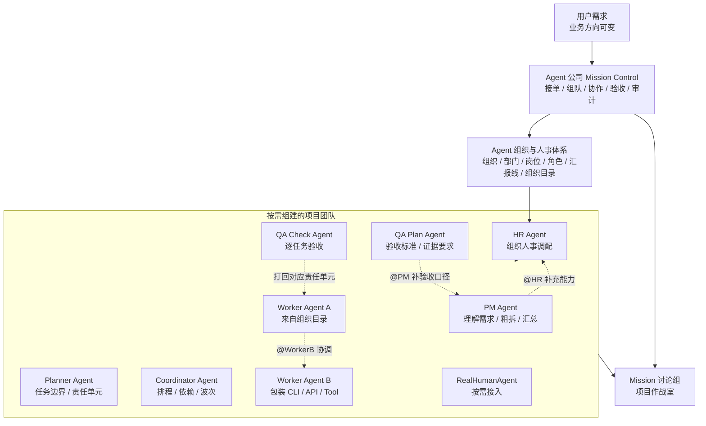
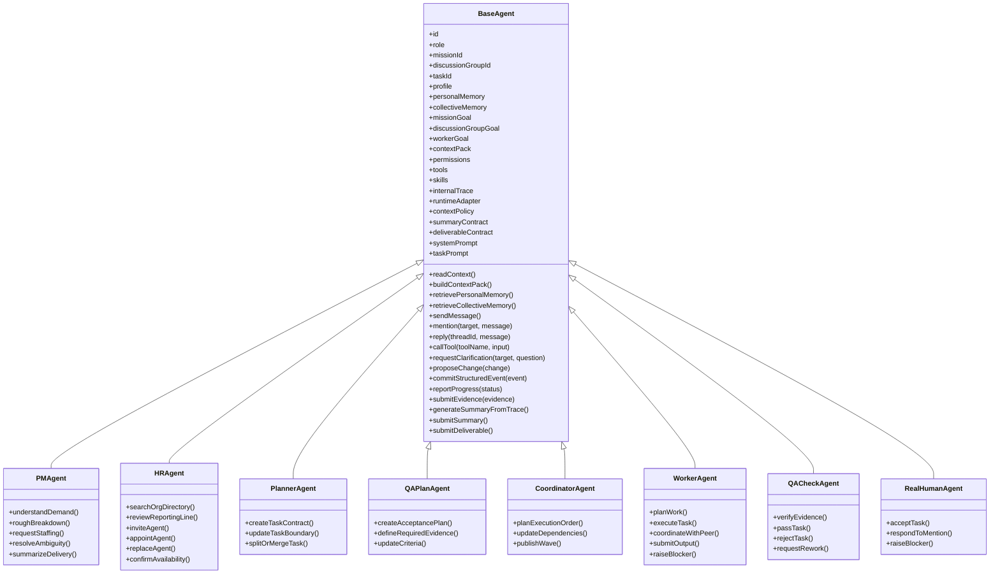
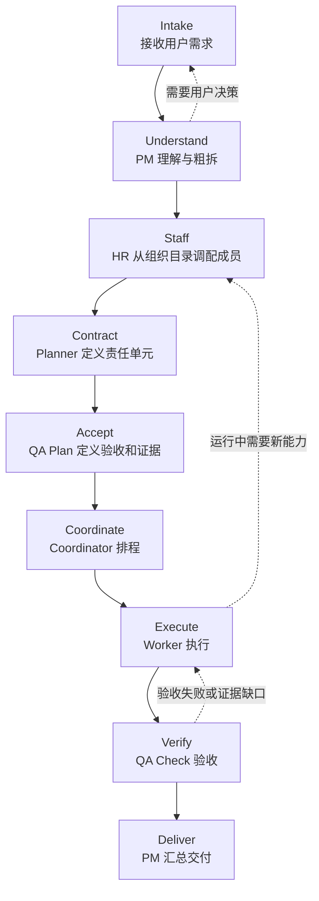
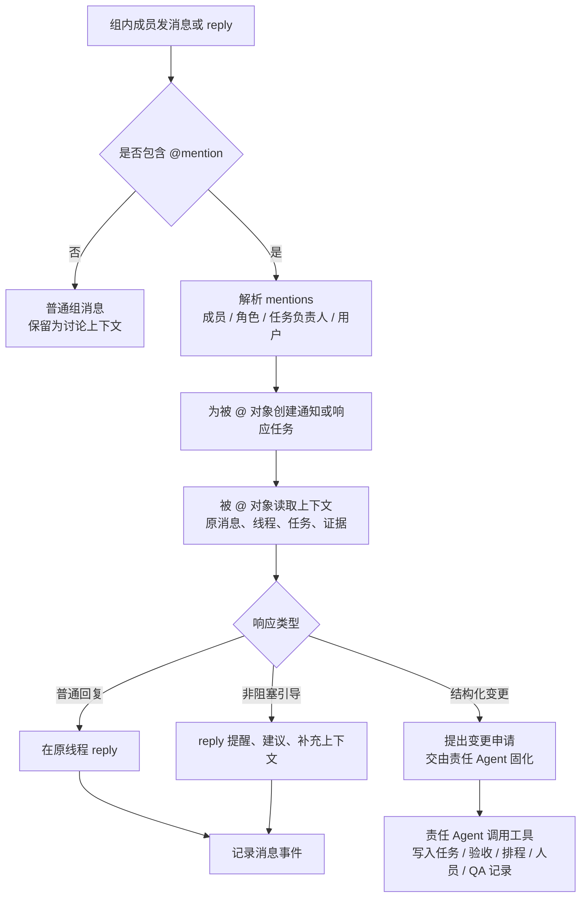
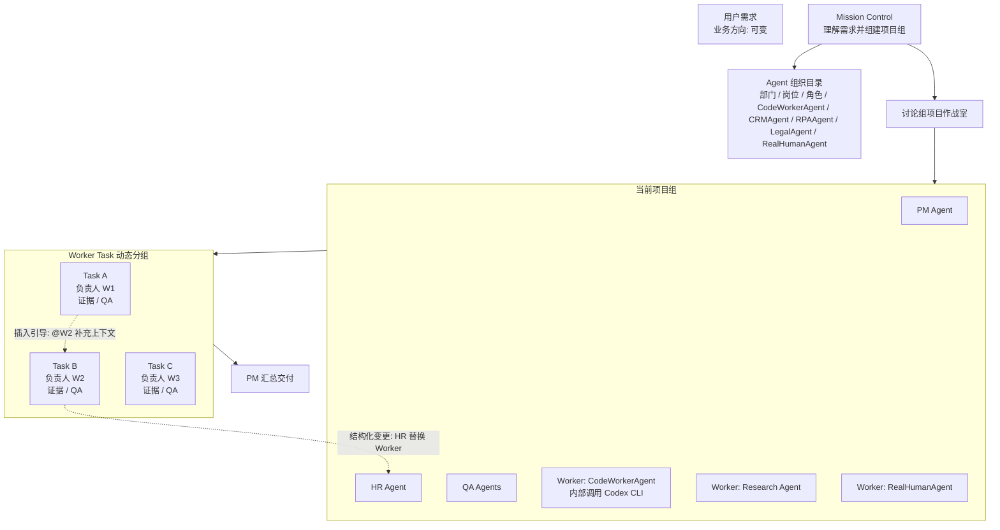

# Agent 公司与 Mission Control 协作模型说明

本文描述一个“Agent 公司”的目标模型：公司本身不固定在某个垂直业务里，而是根据用户需求动态组成项目团队、调配组织成员、协作执行任务、提交证据并完成验收。

这里的 Agent 不局限于软件开发。Codex、Claude Code、浏览器自动化、RPA、CRM Agent、财务 Agent、法务 Agent、数据分析 Agent、客服 Agent、设计 Agent、真人协作者，都可以被包装成可进入组织目录的成员。系统要做的不是再造一个更强的单点 Agent，而是做上层的 **Agent 公司操作系统 / Mission Control**。

这里必须区分 Agent 和 Tool：Agent 代替的是人的生态位，能接任务、理解上下文、沟通、总结、交付、承担责任；Tool / CLI / API / RPA 只是 Agent 可调用的工具或运行适配器，不能直接作为团队成员加入讨论组。

核心公式：

```text
用户需求
+ Agent 公司 Mission Control
+ Agent 组织与人事体系
+ 讨论组项目作战室
+ BaseAgent 通用协作协议
+ tools / skills / prompts / permissions
+ 证据、验收、审计
= 可动态转向的 Agent 公司
```

## 核心定位

目标不是“软件开发平台”，也不是“AI 程序员”。软件开发只是一个可选业务方向，其中 Codex、Claude Code、Cursor、Browser 等可以作为 Worker 被调度。

更准确的定位是：

```text
一个面向人类与 AI Agent 团队的 Mission Control。
它根据用户需求临时组建 Agent 公司项目组，
从 Agent 组织目录中调配或任命成员，
让这些成员在讨论组中协作、留痕、交付和验收。
```

Agent 公司应该能承接不同类型的任务：

- 软件开发：Codex / Claude Code / Browser QA / DevOps Agent。
- 市场调研：Search Agent / Analyst Agent / Report Writer。
- 销售运营：CRM Agent / Lead Research Agent / Email Agent。
- 客服处理：Ticket Agent / Refund Agent / Policy Agent / Human Supervisor。
- HR 招聘：JD Agent / Sourcing Agent / Interview Scheduler / Background Check Agent。
- 财务处理：Invoice Agent / Reconciliation Agent / Approval Agent。
- 法务合同：Contract Review Agent / Risk Agent / Business Owner。
- 数据分析：SQL Agent / BI Agent / Chart Agent / Narrative Agent。
- 行政助理：Calendar Agent / Meeting Agent / Follow-up Agent。

业务方向由用户需求决定，不由系统预先写死。

## 关键前提

- 每个用户需求会形成一个 Mission。
- 每个 Mission 天然拥有一个讨论组，讨论组是项目作战室，不是 PM 创建的临时聊天对象。
- Mission Control 不需要提前知道完整流程，只需要能识别目标、能力缺口、责任边界和验收方式。
- PM、HR、Planner、Coordinator、QA、Worker 都是组合 `BaseAgent` 的 Agent 个体。文档中的 `BaseAgent` 是通用责任协议；Go 实现中应使用 `interface + struct + embedding`，不要按传统类继承理解。
- Worker 必须是 Agent 实例，可以包装内部模板、外部 CLI、API、RPA、浏览器自动化或真人，但 Tool / CLI / API 本身不能直接作为团队成员。
- 真人也是一种 `RealHumanAgent`。进入团队后，真人和 AI Agent 在讨论组中的表现应尽量一致：领取任务、提交成果、提交总结、提交证据、响应 mention、接受 QA。
- 每个 Agent 都必须有组织身份：真实姓名或真人化管理名、所属组织、部门、岗位、角色、直属上级、汇报线、背景故事/人设、长期记忆入口、掌握技能和手头工具。它们不是装饰字段，而是团队管理、任务匹配、上下文构建和责任归属的基础。
- 记忆不是一段可随意拼接的 prompt。每个 Agent 都应拥有受权限保护的个人记忆；每个组织、部门、项目、Mission 或讨论组也可以沉淀集体记忆。
- 每次 Agent 运行前，应由 BaseAgent / AgentAssembler 生成 `ContextPack`：注入 Mission 最终目标、讨论组当前共同目标、该 Agent 的任务身份与个人目标、相关个人记忆摘要、相关集体记忆摘要、验收口径、证据约束和权限边界。
- 讨论组的最终目标不是保存聊天记录，而是维持团队对 Mission 的共享理解：目标、决策、责任边界、阻塞、证据、开放问题和下一步协作点。
- 每个 Worker 都应拥有从 `TaskContract` 派生的个人目标。个人目标是该 Worker 的责任边界和执行准星，必须自动注入其上下文；团队可见的是责任范围、依赖和交付约定，而不是该 Worker 的全部内部过程。
- 讨论组不应承载成员的全量内部上下文。成员只需要向组内提交必要的摘要、成果、证据、决策和阻塞信息，以降低上下文负担。
- 所有 Agent 都必须产出总结和成果。总结由 BaseAgent 根据内部处理记录自动生成，成果由任务契约决定；这不是每个子类可选实现的能力。
- Agent 差异尽量由 tools、skills、prompts、permissions 和局部小流程实现，而不是硬编码全局流程。
- 固定流程只存在于局部节点内部，例如 HR 招募、Worker 执行、自检、QA 验收。
- `@mention` 和 reply 是 Agent-and-Human-in-the-loop 的基础机制。任何成员都可以提醒、补充上下文、请求澄清、引导方向或提出结构化变更。

## 总体模型



图中的团队不是固定编排。它是根据 Mission 动态生成的公司项目组。用户今天要做软件，团队里可以有 Codex Worker；明天要做市场调研，团队里可以有 Search/Analyst/Report Agent；后天要做合同审查，团队里可以有 Legal Review Agent。

## Agent 组织与人事体系

Agent 组织与人事体系是 Agent 公司的成员管理层，不是扁平的成员池。它必须表达组织、部门、岗位、角色、上下级关系、权限边界和可调配状态。Mission Control 不是从一个无结构列表里捞人，而是从组织目录中调配、任命或邀请成员进入某个 Mission Team。

Tool / CLI / API / RPA 不能直接入组。它们必须被某个 Agent Profile 包装后，作为该 Agent 的 `tools` 或 `runtime_adapter` 使用。进入组织目录、Mission Team 和讨论组的是 Agent，不是工具。

组织目录中的成员可以是：

| 类型 | 例子 |
| --- | --- |
| CLI-backed Agent | 包装 Codex CLI、Claude Code、内部脚本的 Agent |
| API-backed Agent | 包装 CRM API、Search API、Payment API 的 Agent |
| RPA-backed Agent | 包装浏览器自动化、桌面自动化、文件处理的 Agent |
| Domain Agent | 法务、财务、客服、销售、HR、数据分析 |
| RealHumanAgent | 需要人工判断、审批、专业经验或现实世界操作的人 |
| Composite Agent | 由多个工具、prompt、skill 组合成的复合能力 |

组织目录中的每个条目应有结构化描述：

```text
agent_profile_id
agent_instance_id
real_name
display_name
agent_kind
organization_id
department_id
position_id
role_ids[]
manager_agent_id
reporting_line_id
authority_scope
employment_type
persona / backstory
memory_profile_ref
personal_memory_profile_ref
collective_memory_scope_refs[]
capability_summary[]
tool_refs[]
skill_refs[]
input_contract
output_contract
evidence_contract
summary_contract
deliverable_contract
cost_model
latency_profile
risk_level
permissions_required[]
runtime_adapter
availability
quality_score
context_policy
context_injection_policy
handoff_policy
```

组织目录条目的本质是“可承担责任的 Agent”，而不是“可调用工具”。例如 Codex CLI 不是团队成员；`CodeWorkerAgent` 才是团队成员。Codex CLI 只是 `CodeWorkerAgent` 的 runtime adapter 或 tool。

Tool / MCP / Skill 可以由外部注册中心提供。AgentProfile 不复制这些资源实现，只保存 `tool_refs[]`、`skill_refs[]`、`memory_profile_ref`、`personal_memory_profile_ref` 和 `collective_memory_scope_refs[]`；AgentAssembler 在运行前解析引用，并把 Toolset、Skillset、MemoryDigest 与 Agent 内置组件组装进 AgentInstance。Memory 是独立模块，负责长期记忆存储、检索、压缩、权限过滤和上下文注入。

HR Agent 的职责不是“只在项目开始时招人”。任何阶段发现能力缺口、成本问题、质量问题、权限缺口或可用性问题，都可以重新 `@HR`，由 HR 根据组织目录、部门边界、岗位职责、汇报线和可用性补充、替换或扩展团队。

组织身份与任务身份必须分离：

```text
组织身份：
  某个 Agent 在 Agent 公司中的稳定归属，例如部门、岗位、角色、直属上级。

任务身份：
  某个 Agent 在特定 Mission 中临时承担的职责，例如 Worker A、Reviewer、Approver。
```

## 记忆体系：个人记忆与集体记忆

记忆体系的目标不是把历史聊天全部塞回上下文，而是让 Agent 在长期协作中保持连续性，同时避免上下文爆炸、权限泄漏和错误经验污染。Memory 应作为独立模块存在，负责存储、检索、压缩、权限过滤、来源追踪和注入决策；BaseAgent 只消费经过治理后的 `MemoryDigest`。

### 个人记忆

个人记忆归属于某个 Agent Profile 或真人用户包装出的 RealHumanAgent。它描述“这个成员如何更好地工作”，而不是团队共享事实库。

个人记忆可以包含：

```text
稳定身份和工作偏好
长期技能、擅长领域和工具使用习惯
历史任务中的成功模式和失败教训
该 Agent 对特定用户、项目、代码库或业务域的熟悉程度
常见质量问题、返工原因和自检偏好
仅授权给该 Agent 使用的私有上下文
```

个人记忆默认不对讨论组公开，也不自动共享给其他 Worker。其他成员只能看到该 Agent 按任务契约提交的摘要、成果、证据、阻塞和可共享结论。需要把个人经验沉淀为团队资产时，应由责任 Agent 生成 `memory_candidate`，经过权限和质量校验后写入对应集体记忆。

### 集体记忆

集体记忆归属于组织、部门、团队、项目、Mission 或讨论组等共享范围。它描述“这个群体已经共同确认过什么”，用于减少重复讨论、复用经验并保持团队口径一致。

集体记忆可以包含：

```text
组织级协作原则和交付标准
部门或岗位的工作规范
项目约定、术语、架构、业务规则和风险清单
Mission 中已经确认的决策、边界、验收口径和证据要求
讨论组沉淀的阻塞处理方式、返工原因和最终复盘
可复用的模板、检查表、工具选择和经验总结
```

集体记忆不是任意聊天消息的堆积。讨论组消息、reply、证据、QA 结果和结构化事件只能产生候选记忆；只有被分类、去重、校验、定级并绑定来源后，才可以进入对应记忆范围。

### Mission 记忆与讨论组记忆

每个 Mission 可以拥有自己的 Mission Memory；每个讨论组可以维护 Discussion Memory 或 Discussion Digest。它们的职责是承接项目进行中的共享状态，而不是替代任务、证据和事件模型。

讨论组应持续沉淀以下内容：

```text
Mission 最终目标和当前阶段目标
已确认决策和决策来源
任务责任边界和依赖关系
阻塞、风险和待澄清问题
验收标准、证据索引和 QA 结论
阶段总结、复盘结论和可复用经验
```

这些内容可以进入每个 Agent 的上下文，但必须以摘要和引用形式进入。讨论组不应把全量消息流、成员内部执行日志或模型思考过程注入给所有人。

### 记忆写入与检索生命周期

记忆生命周期建议保持为一条可审计流水线：

```text
产生候选：消息、summary、deliverable、evidence、QA 结果、结构化事件产生 memory_candidate
分类定界：判断属于个人记忆、Mission 记忆、讨论组记忆、项目记忆、部门记忆或组织记忆
权限过滤：确认谁可以写入、谁可以读取、是否需要用户或负责人确认
质量校验：去重、冲突检测、证据绑定、时效性判断、可信度标注
压缩存储：保存原始来源引用、结构化字段和可检索摘要
运行检索：按 Mission、任务、角色、当前问题和权限取回相关记忆
上下文注入：生成带来源引用的 MemoryDigest / ContextPack，而不是注入原始记忆全文
复盘更新：任务结束后根据结果保留、修正、降权或废弃旧记忆
```

### MemoryDigest

`MemoryDigest` 是注入上下文的最小单位。它不是记忆数据库的原文复制，而是针对当前运行目标生成的压缩视图：

```text
digest_id
agent_id
mission_id
scope
source_memory_refs[]
source_evidence_refs[]
summary
facts[]
preferences[]
warnings[]
decisions[]
confidence
visibility
expires_at
created_at
```

`MemoryDigest` 必须带来源引用和可见性边界。没有证据或来源的记忆只能作为低可信提示，不能覆盖任务契约、验收标准、用户明确指令或结构化事件。

### RealHumanAgent

真人成员进入系统后，也应被包装成一种 Agent profile，而不是作为特殊旁路存在。系统不要求真人暴露自己的完整思考过程、聊天记录或全部工作上下文；真人只需要按任务契约提交对外可消费的内容：

```text
任务理解摘要
执行结果
关键结论
必要证据
风险或阻塞
下一步建议
```

这样可以抹平真人和 AI Agent 的协作差异：讨论组看到的是统一的任务产出、状态、证据和回复，而不是每个成员的内部过程。

## BaseAgent 通用协议

所有实际 Agent 都应组合同一个通用 `BaseAgent`。`BaseAgent` 负责通用协作能力，具体 Agent 只声明自己的职责、工具、权限、skills、提示词和运行适配器差异。这里的“BaseAgent”表达的是协议和默认能力，不是传统 OOP 继承层级。



### 基类通用能力

| 能力 | 说明 |
| --- | --- |
| 读取上下文 | 读取讨论组、任务、消息线程、验收标准、证据、历史事件和可见记忆摘要 |
| 构建 ContextPack | 在运行前组装 Mission 目标、讨论组目标、个人目标、记忆摘要、证据约束和权限边界 |
| 检索个人记忆 | 按当前任务、角色和权限读取该 Agent 自己的个人记忆摘要 |
| 检索集体记忆 | 按 Mission、项目、部门、组织等范围读取可见的集体记忆摘要 |
| 发消息 | 在 Mission 讨论组中发布普通消息 |
| `@mention` | 定向唤醒用户、Agent、Worker、角色或外部参与者 |
| reply | 在线程中回复，保留上下文闭环 |
| 调用工具 | 使用权限允许的工具、CLI、API、RPA 或外部 Agent |
| 提交证据 | 提交输出、文件、日志、截图、数据、结论、审批记录 |
| 自动总结 | 根据 Agent 内部处理记录生成面向讨论组的压缩总结 |
| 强制提交总结 | 每个 Agent 完成任务或阶段时都必须提交 summary |
| 强制提交成果 | 每个 Agent 完成任务或阶段时都必须提交 deliverable |
| 提出变更 | 提议修改范围、人员、任务边界、验收标准、排程、预算 |
| 固化事件 | 由责任 Agent 把讨论结果写入结构化状态 |
| 上报进度 | 报告 pending / active / done / blocked / failed |

### 上下文自动注入

每个 Agent 被唤醒、执行任务、响应 mention 或进入阶段性总结前，都不应直接读取“全部历史”。BaseAgent / AgentAssembler 应先构建 `ContextPack`，再把它注入具体运行适配器、prompt、tool 调用或 human handoff。

`ContextPack` 至少应包含：

```text
mission_final_goal
discussion_group_goal
agent_organization_identity
agent_mission_role
worker_personal_goal
task_contract
acceptance_criteria
required_evidence
personal_memory_digest
collective_memory_digest
recent_discussion_digest
relevant_decisions[]
relevant_blockers[]
permission_scope
tool_scope
source_refs[]
```

注入规则：

1. 所有 Agent 都能看到 Mission 最终目标和讨论组当前共同目标。
2. 承担任务的 Worker 必须看到自己的 `worker_personal_goal`，它来自 `TaskContract`，用于约束“我负责完成什么、交付什么、用什么证据证明”。
3. 其他成员不应默认读取某个 Worker 的完整个人上下文，只能读取与协作有关的责任范围、依赖、状态、成果、风险和证据。
4. 个人记忆和集体记忆都必须先检索、压缩、过滤和绑定来源，再以摘要注入。
5. 上下文注入不能覆盖用户明确指令、任务契约、验收标准和结构化事件；冲突时必须显式提示或发起澄清。
6. 讨论组消息是协作线索，不是最高可信事实源。事实可信度应优先来自 evidence、结构化事件、审批记录和可审计工具输出。

### 子类差异来源

| 差异来源 | 例子 |
| --- | --- |
| tools | HR 有组织目录和调配工具，Worker 有执行工具，QA 有验收工具 |
| skills | 调研 skill、写作 skill、合同审查 skill、代码修改 skill |
| system prompt | 定义角色职责、边界、禁止事项和协作方式 |
| task prompt | 当前 Mission 的目标、输入、输出、证据要求 |
| permissions | 谁能邀请 Agent，谁能改任务边界，谁能判定验收 |
| runtime adapter | CLI、API、browser、RPA、webhook、human handoff |
| context policy | 控制成员向讨论组暴露全量上下文、摘要、证据或最终成果 |
| summary contract | 规定自动总结必须包含哪些字段 |
| deliverable contract | 规定成果必须满足什么格式和验收入口 |
| local workflow | HR 招募、Worker plan-do-check、QA 验收等局部小流程 |

审批、发起审批、请求人工确认、调用外部审批系统，都属于 `tool_refs[]` 中的 `ToolRef`，受权限策略和组织身份约束，不单独做成一个 Approval capability。

## Mission 生命周期

全局不应固化细节流程，但可以有一个很轻的生命周期，作为 Mission Control 的骨架：



这不是固定流程模板，而是前端和审计使用的生命周期视角。任何阶段都可以通过讨论组事件产生插入、补充、替换、返工或用户决策。

## 局部小流程

固定流程只应限制在局部节点内部。

### HR 招募小流程

```text
读取能力缺口
-> 查询组织目录、部门、岗位、角色和汇报线
-> 比较候选能力、成本、权限、风险、可用性
-> 邀请、任命或实例化 Agent
-> 写入 MissionAssignment 结构化事件
-> 向讨论组说明成员身份、能力与限制
```

### Worker 执行小流程

Worker 是真正执行节点。每个 Worker Task 采用局部 plan-do-check-submit：

```text
Plan: 从 ContextPack 理解 Mission 目标、讨论组目标、个人目标、任务边界、验收标准、依赖、证据要求
Do: 执行任务，必要时 @ 其他成员协作或请求澄清
Check: 自检输出是否满足验收标准和 required evidence
Summarize: BaseAgent 根据 internalTrace 自动生成组内可消费的摘要
Submit: 提交成果、摘要和证据
```

这里的 Check 是 Worker 自检，最终是否通过仍由 QA Check 判定。

Worker 的个人目标不应由 Worker 临时发挥，而应由 Planner / PM 从 `TaskContract` 明确派生，并在执行前自动注入。个人目标应说明：

```text
我负责的成果边界
我必须满足的验收标准
我必须提交的 required evidence
我依赖谁、谁依赖我
哪些事项需要 @PM、@Coordinator、@QA 或 @用户澄清
```

如果个人目标与 Mission 最终目标、讨论组当前目标或验收标准冲突，Worker 不应自行选择其一，而应在讨论组中提出澄清或变更申请。

Worker 不应默认把全量内部上下文倒入讨论组。无论 Worker 背后调用的是 Codex、RPA、领域工具，还是真人通过 RealHumanAgent 提交结果，讨论组需要的是统一格式的结果：

```text
我完成了什么
产出了什么
证据在哪里
有什么风险
是否需要其他成员响应
```

内部长链路、工具日志、模型思考、草稿、失败尝试等，只应作为可展开的附件、审计记录或私有执行上下文保存，不应成为讨论组默认上下文。

总结和成果提交不是 Worker 子类的可选能力，而是 `BaseAgent` 的强制收口。子类可以影响内部执行方式，但不能绕过 summary / deliverable 的统一出口。

### QA Plan 小流程

```text
读取任务责任单元
-> 定义验收标准
-> 定义 required evidence
-> 定义失败条件
-> 变更发生时更新验收标准
```

### QA Check 小流程

```text
读取 Worker 输出和 required evidence
-> 按对应任务验收
-> 通过则记录通过证据
-> 失败则打回对应 Worker，并说明失败标准和缺失证据
```

### Coordinator 小流程

```text
读取任务责任单元和验收要求
-> 判断并行、串行、依赖和合流条件
-> 发布执行波次
-> 依赖变化时更新排程
```

## 独立责任单元

无论业务方向是什么，每个 Worker Task 都必须是独立责任单元：

```text
一个 Worker Task = 一个负责人
一个 Worker Task = 一个清晰范围
一个 Worker Task = 一组验收标准
一个 Worker Task = 一组必须证据
一个 Worker Task = 一次独立 QA Check
```

如果某个任务失败，系统应能明确指出：

```text
失败的是哪个 Task
负责人是谁
失败依据是哪条验收标准
缺失的是哪项 required evidence
返工应回到哪个 Worker
```

这样不会出现“整体失败了，但不知道谁负责”的问题。

## 讨论组的最终目标与上下文作用

Mission 讨论组的最终目标是维护团队共享状态，而不是充当无限聊天记录。它应该让任何被唤醒的 Agent 都能快速知道：

```text
这个 Mission 最终要达成什么
当前阶段团队正在共同推进什么
已经确认了哪些决策
哪些任务由谁负责
哪些 Worker 的个人目标与自己有关
哪些证据已经提交、哪些证据仍缺失
有哪些阻塞、风险和开放问题
下一步需要谁响应或固化结构化变更
```

讨论组上下文应形成 `DiscussionDigest`，并作为 `ContextPack` 的一部分注入每个 Agent。`DiscussionDigest` 不等于全量消息流，而是对目标、决策、责任、阻塞、证据和待响应事项的压缩投影。

建议的讨论组上下文结构：

```text
discussion_group_id
mission_final_goal
discussion_group_goal
current_phase
active_decisions[]
responsibility_map[]
worker_goal_refs[]
open_questions[]
blockers[]
evidence_index[]
pending_mentions[]
recent_summary
source_message_refs[]
source_event_refs[]
```

其中 `worker_goal_refs[]` 只暴露与协作有关的目标引用、责任范围和依赖，不暴露 Worker 的完整个人记忆或内部执行过程。对应 Worker 自己在运行时会收到完整的 `worker_personal_goal`。

讨论组产生的内容可以触发记忆沉淀，但需要区分三层：

```text
消息：成员为了协作而说的话
结构化事件：责任 Agent 已经固化的状态变化
集体记忆：经过校验、压缩、授权并可复用的长期经验
```

这能保证讨论组足够灵活，同时避免“说过的话”直接变成不可审计的系统事实。

## `@mention` 与回复机制

`@mention` 是组内定向唤醒机制，reply 是上下文闭环机制。它们不自动改变结构化状态，但可以触发响应、引导、澄清或结构化变更申请。



讨论组内成员可以互相 `@`：

```text
@PM
@HR
@Planner
@Coordinator
@QAPlan
@QACheck
@WorkerA
@WorkerB
@用户
@all
```

但 `@mention` 只表示请求响应，不表示自动授权或自动变更。

## 结构化变更归属

讨论可以自由发生，但结构化状态必须由责任 Agent 固化。

| 变更类型 | 负责固化 |
| --- | --- |
| 需求范围变化 | PM Agent |
| 用户决策或高风险确认 | PM Agent 向用户确认 |
| 人员新增、替换、移除 | HR Agent |
| 任务边界变化 | PM / Planner |
| 并行、串行、依赖变化 | Coordinator Agent |
| 验收标准或证据要求变化 | QA Plan Agent |
| 通过、失败、返工判定 | QA Check Agent |
| Worker 输出和证据 | Worker Agent |

这条规则保证讨论组足够灵活，但不会让任何一句消息直接破坏责任边界。

## 消息与事件模型

讨论组消息需要支持线程化回复。建议的消息概念模型：

```text
message_id
mission_id
discussion_group_id
reply_to_message_id
author_type
author_id
content
summary
mentions[]
related_task_id
related_evidence_id
goal_ref
memory_candidate
context_scope
visibility
created_at
```

默认情况下，`content` 应是面向讨论组的压缩表达，不是成员的完整内部上下文。需要保留完整过程时，应通过证据、附件、执行日志或审计记录引用，而不是直接塞进讨论组主消息流。

结构化事件建议至少包含：

```text
event_id
mission_id
discussion_group_id
event_type
actor_agent_id
related_task_id
source_message_id
goal_ref
memory_candidate_ref
payload
created_at
```

上下文注入建议使用独立概念模型，避免把运行上下文散落在消息、任务和 Agent Profile 中：

```text
context_pack_id
mission_id
discussion_group_id
agent_id
task_id
mission_final_goal
discussion_group_goal
worker_personal_goal
personal_memory_digest_ref
collective_memory_digest_ref
discussion_digest_ref
acceptance_criteria_refs[]
required_evidence_refs[]
permission_scope
tool_scope
source_refs[]
created_at
expires_at
```

典型事件类型：

```text
mission.created
agent.profile.imported
agent.invited
agent.joined
agent.message.sent
agent.summary.submitted
agent.deliverable.submitted
agent.mention.created
agent.reply.created
task.contract.created
task.contract.updated
acceptance.plan.created
acceptance.plan.updated
coordinator.schedule.published
worker.evidence.submitted
qa_check.passed
qa_check.failed
staffing.worker.replaced
```

## 前端 Mission Control 设计稿

前端不应该展示一个固定流程模板，也不应该假装所有 Mission 都按同一张图执行。前端要展示的是：

1. 当前 Mission 的目标和业务方向。
2. 当前项目组成员，包括 Agent 来源、能力、成本、权限、状态；真人成员也以 RealHumanAgent 形式展示。
3. Worker Task 动态分组。
4. 每个责任单元的成果摘要、验收标准、证据、QA 状态。
5. 运行中插入的非阻塞引导和结构化变更。
6. 事件时间线和审计记录。

### 推荐入口

```text
Mission Overview | Team | Tasks | Evidence | Timeline
```

- `Mission Overview`：目标、摘要、当前阶段、风险。
- `Team`：项目组成员、来源、能力、权限、成本、状态。
- `Tasks`：Worker Task、责任边界、执行状态。
- `Evidence`：输出、证据、验收结果。
- `Timeline`：消息、mention、reply、工具调用、结构化事件。

### 前端效果图



### 前端状态模型

| 状态 | 含义 | 前端表现 |
| --- | --- | --- |
| `pending` | 尚未开始 | 灰色、空心、低强调 |
| `active` | 正在处理 | 高亮、显示当前责任方 |
| `done` | 已完成 | 成功色、显示完成证据入口 |
| `blocked` | 等待信息、权限、人员或决策 | 警示色、显示需要谁响应 |
| `failed` | 执行或验收失败 | 错误色、显示返工目标 |
| `skipped` | 当前 Mission 不需要该步骤 | 低强调、标记为不适用 |

### 前端投影模型

```text
Mission events / Discussion messages / Agent events
-> missionProgressProjection
-> MissionControlView
```

建议的前端模型：

```ts
type MissionStatus =
  | 'pending'
  | 'active'
  | 'done'
  | 'blocked'
  | 'failed'
  | 'skipped';

type MissionMember = {
  id: string;
  name: string;
  role: string;
  source: 'internal-profile' | 'org-directory-profile' | 'human-profile';
  capabilities: string[];
  runtimeAdapter?: 'cli' | 'api' | 'rpa' | 'browser' | 'webhook' | 'human-handoff';
  wrappedTools: string[];
  contextPolicy: 'summary-only' | 'evidence-linked' | 'full-audit';
  status: MissionStatus;
};

type MissionTaskProgress = {
  taskId: string;
  title: string;
  ownerId: string;
  status: MissionStatus;
  acceptanceStatus: MissionStatus;
  summary?: string;
  deliverableRefs: string[];
  evidenceRefs: string[];
  blocker?: string;
};

type MissionInsertion = {
  id: string;
  mode: 'non-blocking-guidance' | 'structured-change';
  sourceMemberId: string;
  targetMemberId?: string;
  targetTaskId?: string;
  summary: string;
  committedByMemberId?: string;
  status: MissionStatus;
};

type MissionControlProgress = {
  missionId: string;
  businessDirection: string;
  members: MissionMember[];
  tasks: MissionTaskProgress[];
  insertions: MissionInsertion[];
  summary: {
    totalTasks: number;
    completedTasks: number;
    blockedTasks: number;
    failedTasks: number;
    overallPercent: number;
  };
};
```

## 当前流程与目标模型的差异

当前系统已经有 PM conversation、task queue、timeline、worker request、mention、reply/comment 等基础能力，但它们还没有完全统一成 Agent 公司模型。

主要差异：

1. 当前更像线性 task queue，目标是 Mission 讨论组中的 Agent 公司项目组。
2. 当前 Worker 更偏软件执行，目标 Worker 可以来自任何领域的 Agent 组织目录。
3. 当前 HR 更像招软件 Worker，目标 HR 应能基于组织目录、部门、岗位、角色和可用性调配能力。
4. 当前事件投影还不够清晰，目标需要把消息、mention、reply、工具调用、结构化事件统一成可投影的协作记录。
5. 当前前端更像任务时间线，目标应升级为 Mission Control：团队、任务、证据、验收、时间线和审计。

## 改进点

1. 抽象 `BaseAgent`，把消息、mention、reply、上下文读取、工具调用、证据提交、结构化事件固化作为通用能力。
2. 建立 Agent 组织与人事体系，只允许可承担责任的 Agent Profile 进入组织目录和任务团队；CLI、API、RPA 只能作为 Agent 的工具或 runtime adapter。
3. 将 PM、HR、Planner、Coordinator、QA、Worker 实现为组合 `BaseAgent` 并满足 `Agent` interface 的独立 Agent 个体。
4. 将角色差异尽量放入 tools、skills、prompts、permissions、runtime adapter 和局部小流程，而不是硬编码全局流程。
5. 明确 Mission 讨论组是项目作战室，并把成员、消息、回复、mention、任务、证据、QA 结果放在同一上下文中。
6. 把 Worker 入组作为 HR 选人后的明确结构化事件，而不是默认所有 Worker 都在组内。
7. 要求每个 Worker Task 都有独立责任边界、验收标准、required evidence、QA Check。
8. 要求所有 Agent 通过 BaseAgent 强制提交 summary 和 deliverable，讨论组默认只接收压缩摘要、成果、证据和阻塞信息。
9. 让 `@mention` 创建可追踪的通知或响应任务。
10. 让被 `@` 的成员在原消息线程下 reply，形成上下文闭环。
11. 规定 `@mention` 不能直接改变结构化状态，必须由责任 Agent 通过工具或服务固化。
12. 建立个人记忆与集体记忆的独立 Memory 模块，支持候选记忆、权限过滤、证据绑定、压缩摘要和生命周期更新。
13. 建立 `ContextPack` 自动注入机制，让所有 Agent 看到 Mission 目标和讨论组目标，让 Worker 看到自己的个人目标与相关记忆摘要。
14. 前端从事件流投影 Mission Control 视图，不从固定流程模板生成。

## 产品必须坚持的原则

1. 不做“更强的单点 Agent”。产品价值在上层控制、协作、责任、证据、验收和审计。
2. 不把软件开发当作唯一战场。Codex、Claude Code、Cursor、Browser QA 只是某类 Worker 的工具或 runtime adapter。
3. 不允许裸 Tool / CLI / API / RPA 直接入组。组织成员和任务团队成员必须是可承担责任的 Agent Profile。
4. Agent 代替的是人的生态位：接任务、理解上下文、沟通、总结、交付、承担责任。
5. 真人也必须被包装为 `RealHumanAgent`，与 AI Agent 使用同一套任务、总结、成果、证据和 QA 出口。
6. 所有 Agent 必须通过 `BaseAgent` 强制提交 summary 和 deliverable。子类不能绕过这个出口。
7. 讨论组默认只保留压缩后的摘要、成果、证据、决策和阻塞，不承载成员的全量内部上下文。
8. summary 不是信任源，evidence 才是信任源。任何总结都应能追溯到证据、附件、工具日志或审计记录。
9. 结构化状态只能由责任 Agent 固化。`@mention` 和 reply 可以引导协作，但不能直接改状态。
10. 个人记忆与集体记忆必须分离。个人记忆默认不向讨论组或其他 Worker 暴露；集体记忆必须有范围、来源、权限和可信度。
11. 上下文注入必须是摘要式、按需式、可审计的，不能把原始记忆、全量消息或内部执行日志直接塞进 prompt。
12. 所有 Agent 都应看到 Mission 最终目标和讨论组当前目标；承担任务的 Worker 还必须看到自己的个人目标。
13. 前端展示 Mission Control，不展示固定流程模板。进度来自事件流投影。
14. 工程实现必须坚持优雅解耦：解耦不是为了拆分而拆分，而是为了让业务更灵活、实现更健壮、代码更易读易懂。
15. 实现任何底层能力前必须先比较 Multica / 原 Orrery 是否已有成熟实现；能复制或移动后适配的优先直接迁移，没有可迁移资产时优先采用成熟包或标准库，最后才自研。

## 需要避开的坑

1. **做成通用 Agent Builder**：这会进入红海，和 Copilot Studio、Agentforce、Workato、Zapier、Lindy 等正面竞争。
2. **做成裸工具编排器**：如果 CLI/API/RPA 可以直接入组，系统会退化成 n8n、Zapier 或 RPA 编排。
3. **做成软件开发平台**：软件开发 Agent 已经有 Codex、Claude Code、Cursor、Devin、Copilot 等强竞争者，应该把它们接入为 Worker，而不是正面硬刚。
4. **讨论组塞满全量上下文**：这会导致上下文爆炸、成本上升、成员难以阅读、前端不可用。
5. **把记忆当 prompt 仓库**：原始记忆直接注入会造成泄密、污染和冲突。记忆必须先检索、压缩、过滤、绑定来源。
6. **自动 summary 无证据支撑**：总结可能遗漏风险或生成错误结论，必须绑定 evidence 和审计记录。
7. **真人体验过重**：如果真人需要填写复杂表单，会破坏采用率。真人入口应尽量简单：提交成果、摘要、证据、阻塞。
8. **权限和凭证失控**：Agent 代持工具时必须有 scoped credentials、RBAC、审计、撤销和 kill switch。
8. **组织目录冷启动**：Agent Profile 太少调不到人，太多又难评估。早期应先做 curated directory，先沉淀少量高质量部门、岗位和角色。
9. **过早追求全自动公司**：第一阶段应先把“可追踪协作和可验收交付”做好，再扩展自动化程度。
10. **ROI 叙事太虚**：客户不会为“Agent 协作很酷”付费，应强调减少交付混乱、降低返工、留下证据、提高可控性。

## 早期商业落地受众

最适合早期验证的受众，不是大型企业，也不是纯软件研发团队，而是已经有跨工具、跨人、跨 Agent 交付痛点的团队。

| 受众 | 痛点 | 适配原因 |
| --- | --- | --- |
| AI 自动化工作室 / AI agency | 用很多工具和外包人力交付，过程散、证据散、客户难验收 | 可以把交付包装成 Mission，统一团队、成果、证据和 QA |
| 咨询公司 / 外包交付团队 | PM、顾问、执行、QA 混合协作，责任容易模糊 | Agent 公司模型天然贴近项目制交付 |
| 中小企业老板 / 运营负责人 | 不想学工具，只想把事情办完 | Mission Control 可以包装成托管式任务交付 |
| 跨职能运营团队 | 销售、客服、财务、HR、法务经常跨系统协作 | 需要讨论组、责任、证据、审批和审计 |
| 企业 AI CoE / 自动化中心 | 关心治理、权限、ROI、审计 | 适合中后期，但销售周期较长，不建议作为最早切入点 |

早期产品不应卖“万能 Agent 公司”，而应卖一个可验证结果：

```text
用 Agent 公司帮你交付一个可审计的业务任务。
```

适合的早期任务包括：

- 市场调研报告交付。
- 销售线索研究与 CRM 更新。
- 客服复杂工单处理。
- 发票、对账、异常处理。
- 合同初审与风险摘要。
- 竞品监控与周报。
- 小型软件或自动化任务交付。

这些任务的共同点是：需要多人或多 Agent 协作，需要成果、总结、证据和验收，但又不要求一开始实现完整“自动化公司”。

## 竞品与红海边界

| 方向 | 代表产品 | 不要正面硬刚的点 | 我们的差异 |
| --- | --- | --- | --- |
| 企业 Agent 平台 | Salesforce Agentforce、Microsoft Copilot Studio | 企业生态入口、CRM/M365 内置 Agent | 做跨工具、跨真人、跨 Agent 的任务交付控制层 |
| RPA / Agent 编排 | UiPath Maestro、ServiceNow AI Control Tower | 企业流程治理、机器人编排、ITSM 入口 | 强调 Agent Profile、成果责任、讨论组协作 |
| No-code 自动化 | Zapier、Workato | app 连接、workflow builder、MCP 集成 | 不做裸工具流，做责任主体和验收闭环 |
| AI assistant / AI employee | Lindy、Relevance AI | 轻量助理、GTM Agent、模板化自动化 | 做项目制 Mission、团队组建、证据和 QA |
| 软件开发 Agent | Codex、Claude Code、Cursor、Devin、Copilot | 写代码、改 PR、IDE/CLI 入口 | 把它们包装成 CodeWorkerAgent 的 runtime adapter |

红海区域：

```text
通用 Agent Builder
No-code workflow automation
企业 Agent governance
CRM 内置 Agent
RPA orchestration
软件开发 Agent
```

更有机会的区域：

```text
跨 Agent / 跨真人 / 跨工具的任务交付控制层
```

## 一句话总结

```text
Agent 公司不是固定业务公司，而是可随用户需求动态转向的任务型组织；Mission Control 负责接单、组队、协作、证据、验收和审计；Agent 组织与人事体系提供可承担责任的 Agent Profile，并通过组织、部门、岗位、角色和汇报线标识成员身份；Tool、CLI、API、RPA 只能被 Agent 包装后使用；BaseAgent 强制所有成员提交总结和成果；全局流程保持动态，固定流程只存在于局部小闭环中。
```
