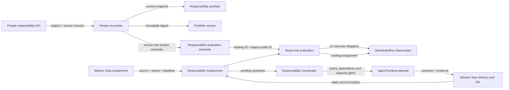

# 责任系统数据流

本文描述当前 People 长期职责、Orrery Responsibility、Mission Task、Scheduler 和 Agent Runtime 之间的生产数据流。它记录已经实现的边界，不把职责描述文本当作可执行指令。

## 总体流程

`People portfolio` 表达长期职责，`Responsibility Assignment` 表达已经存在的具体义务。只有后者进入执行协调器。

## 两个独立循环

### 1. People 同步与评估循环

1. People reconciler 按绑定读取一个 subject 的有效职责。
2. 当前结果保存为 `PeopleResponsibilityPortfolio`，内容摘要保存为 `SourceDigest`。
3. 每个不同摘要保存一份不可变 `PeopleResponsibilityPortfolioVersion`。
4. reconciler 为有效 portfolio 创建或更新一个系统管理的 `responsibility_evaluation` Scheduled Task。
5. 每次触发只读取最新 portfolio 和该 Agent 的结构化 Assignment。
6. 评估结果写入 `ScheduledRun.ResponsibilityEvaluation`，不会因为 portfolio 描述文字创建 Mission。

### 2. 具体义务执行循环

1. Mission Task 被指派时，同一事务创建或更新 `ResponsibilityAssignment` 和 `ResponsibilityActivation`。
2. Assignment 保存 Task 的 `SourceKind`、`SourceID`、`SourceStepID`，从而保留 Todo、Scheduler 或其他上游来源。
3. coordinator 仅领取满足依赖、策略、权限、预算、风险和容量约束的 Activation。
4. 每次执行形成独立 `ResponsibilityAttempt`；Runtime 完成不等于责任完成。
5. 结果必须回到 Mission Task 的提交、证据和 QA 流程。
6. Task 状态再同步为 Assignment 的 `waiting`、`submitted`、`fulfilled`、`escalated` 等状态。

## 评估决策

| 条件 | `decision_kind` | 行为 |
| --- | --- | --- |
| 没有具体 Assignment | `no_action` | 只保存观测结果 |
| 只有 waiting、submitted、escalated、paused 或无效 Assignment | `no_action` | 保存状态分布，不启动 Runtime |
| 存在 offered、accepted 或 active Mission Task Assignment | `link_existing_mission` | ScheduledRun 关联已有 Mission、Task 和 Responsibility，不创建副本 |
| 未来接入带 `source_ref` 的结构化行动信号 | `materialize_action` | 允许经现有 Agent Task 路径生成 Mission Task；纯文本职责不能进入此路径 |

多个可执行 Assignment 按以下稳定顺序选择一个用于观测关联：

1. 优先级更高；
2. 截止时间更早；
3. 接责期限更早；
4. 创建时间更早；
5. Assignment ID 字典序。

选择只影响本次评估关联，不替代 coordinator 的领取与执行策略。

## 谱系字段

| 层级 | 关键字段 | 用途 |
| --- | --- | --- |
| People portfolio | `BindingID`, `SourceRevision`, `SourceDigest` | 标识当前上游快照 |
| Portfolio version | `PortfolioVersionID` | 固定一次不可变职责版本 |
| Scheduled Task | `SourceScopeKind`, `SourceScopeID`, `AgentID` | 将评估绑定到唯一 People portfolio |
| Evaluation result | portfolio 版本、候选状态计数、`DecisionSourceRef` | 解释本次为什么行动或不行动 |
| Mission Task | `SourceKind`, `SourceID`, `SourceStepID` | 标识具体工作来自哪里 |
| Responsibility Assignment | Mission Task 来源副本、owner、state、version | 在任务读取失败或历史回放时仍保留来源 |
| Scheduled Run | `MissionID`, `TaskID`, `ResponsibilityID` | 关联观测结果与具体义务 |
| Attempt | `ActivationID`, `AgentRunID`, outcome | 记录一次执行尝试，不充当完成凭证 |

旧 Assignment 的来源字段为空时，可在相同 Mission Task 再次指派或历史回放时补齐；已存在且不同的来源会以冲突失败，不能静默改写谱系。

## 必须保持的约束

- People 是长期职责事实来源，Orrery 不向 People 回写 Mission 执行状态。
- portfolio 描述、标题和责任胶囊不能直接成为 `TaskGoal` 或 Prompt。
- Scheduled Task 是触发规则，Scheduled Run 是观测记录，两者都不是业务完成记录。
- 一个 Runtime Attempt 完成后仍必须经过 Task 提交、证据和 QA。
- 任何可执行决策必须关联已有 Assignment，或提供可审计的结构化 `source_ref`。
- tenant、Agent、portfolio binding、Mission、Task 和 Responsibility 引用必须由服务端交叉校验。
- 同一 scheduled run、Assignment 和 Activation 的重放必须幂等。

## 观测入口

- People/Workforce 责任档案：查看当前 portfolio、历史版本、同步缺口和 pulse Scheduled Task。
- Scheduled Tasks 运行历史：查看 portfolio 版本、候选状态分布、决策、选中的 Assignment 来源以及 Mission/Responsibility 链接。
- Responsibility Ops：查看 Assignment、Activation、Attempt、Blocker、监督告警、证据完整度和最终状态。
