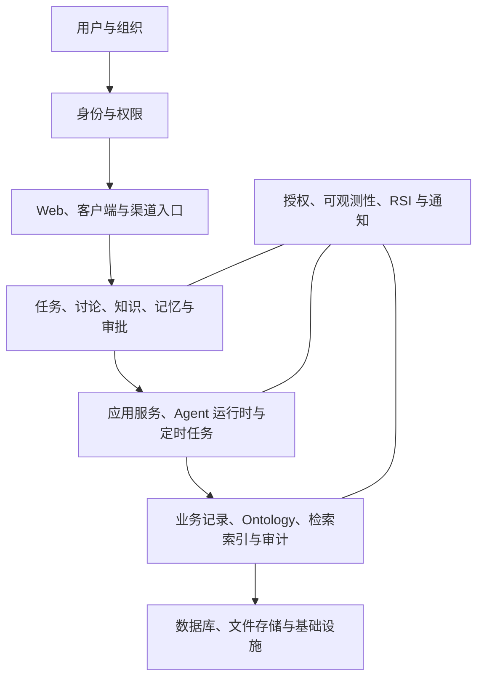

# Orrery 全景架构（2026-10-15）

覆盖用户与组织、身份权限、接入入口、业务功能、应用服务、数据资产、存储与基础设施。Ontology、RSI、定时任务、知识库、记忆库、审批 HIL、MCP、Skills、通知与审计均已纳入。

[查看 PDF 总览](./Orrery-全景架构.pdf) · [下载完整文件包](./Orrery-全景架构.zip) · [交互版入口文件](./orrery-panorama.html)

GitHub 可以直接预览下方图片和 PDF。交互 HTML 请下载完整文件包，解压后用浏览器打开 `orrery-panorama.html`；四个 HTML 文件需保留在同一目录。

总览使用可编辑源码；四个详细视图及实现状态见下文。

## 四个视图

| 视图 | 文件 | 内容 |
| --- | --- | --- |
| 全景总览 | [orrery-panorama.html](./orrery-panorama.html) | 用户与组织、接入、功能、应用、数据、基础设施六层及跨层治理 |
| 功能地图 | [features.html](./features.html) | 用户、业务功能、实现服务、数据及技术范围的分解 |
| 应用与数据 | [data.html](./data.html) | 服务负责的数据域，以及知识、记忆向 Ontology 的元数据投影 |
| Ontology 与 RSI | [rsi.html](./rsi.html) | 评估产物、候选版本、晋级门禁、原子发布、回滚、运行时版本绑定与审计 |

深入图由 [Archify](https://github.com/tt-a1i/archify) 3.1.0 生成。可编辑图形源文件为 [features.candidate.json](./features.candidate.json)、[data.candidate.json](./data.candidate.json)、[rsi.candidate.json](./rsi.candidate.json)。各深入图保留节点源码引用及导出功能；PDF 为全景总览的单页静态版本。生成查看器嵌入的 Archify 运行时代码按其 Apache-2.0 条款分发，许可证、NOTICE 和第三方组件/品牌标记声明保存在 [ARCHIFY-LICENSE.txt](./ARCHIFY-LICENSE.txt)、[ARCHIFY-NOTICE.txt](./ARCHIFY-NOTICE.txt) 与 [ARCHIFY-THIRD_PARTY_NOTICES.md](./ARCHIFY-THIRD_PARTY_NOTICES.md)。

## 源码范围与实现状态

本版整合不同分支的源码能力，不是某个线上版本的部署清单：

- 云端与 RSI 依据本地源快照。
- 客户端概览依据本地源快照，标明迁移状态。
- RSI 已有候选版本与包快照、可信评估记录、基线检查、受控晋级、回滚和事务审计能力；真实生成器、隔离对照执行、独立裁判和完整自动反馈闭环仍需建设，图中已分别标明。

三个深入图在生成时均通过 Archify 的 validate、deliver、check 和 browser-check。入口页已检查桌面与手机宽度、四个页签加载及键盘切换；发布文件与本地产物逐一比对 SHA-256。
