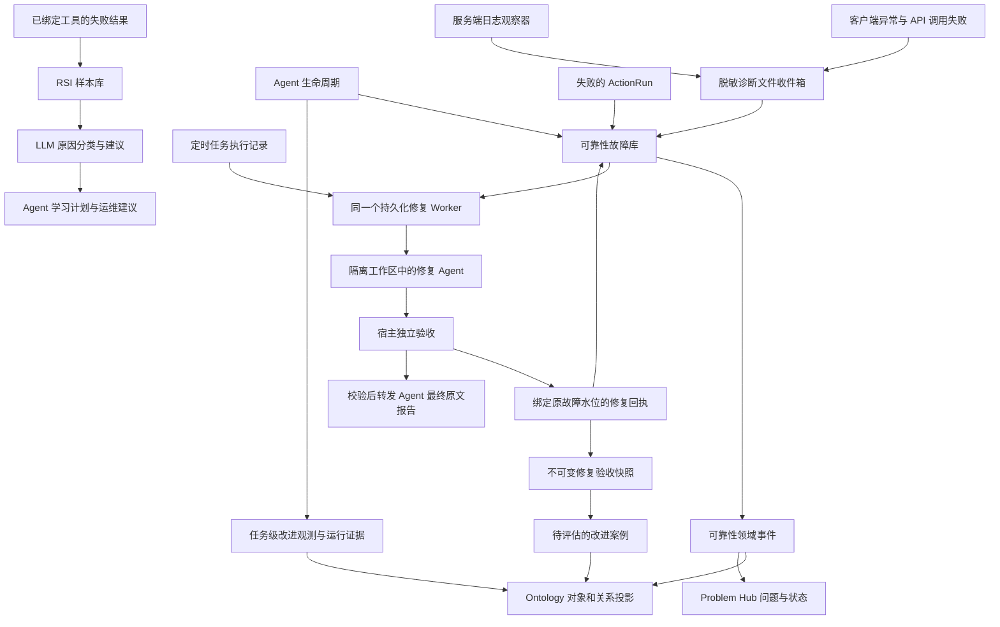

# 故障中心、Ontology 与 RSI 的实际边界

本说明依据 2026-10-17 线上实际源码快照、已部署的 `05dfe340` 托管修复 Worker，
以及本版本的修复反馈接线核验。发布合成基线为
`ontology-assertion-time-20261017-1a7cf201`；已保留此前上线的宿主执行证据、
正式任务验收、Agent 参数纠正、提示词精简和知识断言时效更新。
Worker 保留版本化设计基线检索要求及 Agent 原文报告约束。
实际源码由多个已发布增量合成，完整来源以发布清单和 `SOURCE_SNAPSHOT.tar.gz`
为准，不能仅凭名义提交号推定其全部内容。
线上配置为 `sources=[scheduled,failure_center]`、`execution_mode=direct`、
`direct_runtime=codex`、`batch_size=1`、`max_attempts=1`、运行超时 3600 秒；
`ORRERY_RSI_MODE=llm`。配置可以独立变化，以下代码行为与这些部署取值分开描述。

图中的 RSI 建议没有自动指向发布、任务重跑或故障关闭。当前代码没有建立这种授权关系。

## 故障怎样进入中心

审批通知增量修复（2026-10-18，是否已激活以独立发布回执为准）：
HIL 入队失败直接写入同一个持久化诊断收件箱，不再依赖数据库更新成功后是否抛出异常。
渠道投递保留内部脱敏 provider cause，按实际租户、渠道、账号及收件人区分事件；
公开投递记录继续使用安全错误摘要。已持久化的渠道异常给 relay 带捕获标记，避免再生成
一条没有收件人上下文的通用事件。原消息/尝试编号作为诊断去重键，不产生新的通知发送键。
原有日志、客户端、Agent/ActionRun、修复反馈和 RSI 入口全部保留。

发送前重新检查待审批工作流、decision、当前任务/受理人及期限；已结束、过期或转交的通知
记为 `cancelled`，不冒充 `delivered`。尚未成功入队的失败指数退避，8 次派发尝试后记为
`needs_attention`，保留故障和原错误，不继续无界重试；已有投递的暂时状态读取失败只轮询
同一投递，并在收件箱留下去重诊断，不创建第二条消息。
审批人微信死信恢复由仍待本人处理的真实审批授权，重新核对来源、原绑定、账号和
`approvals.read`；不再错误依赖可选的 attention 提醒名单。可选提醒仍遵守原 opt-in。
恢复沿用原 Agent 正文、delivery ID、provider 幂等键、30 分钟冷却和累计最多 24 次预算；
永久失败、已送达或不再有效的事项不重开。旧死信只在仍有效且通过同样校验时记录与恢复。
这里没有扩大修复 Worker 的尝试次数，也不重派历史 needs_attention 修复或修改业务审批结论。

- [production_failure_capture.go](../cmd/server/production_failure_capture.go)
  注册服务端日志观察器和 `reliability.failure_capture` 扫描器。错误级日志，或携带
  `error` / `error_cause` 字段的日志，写入脱敏诊断收件箱；排除收件箱自身错误以避免递归。
- [error-reporting.ts](../web/src/lib/runtime/error-reporting.ts) 与
  [hooks.client.ts](../web/src/hooks.client.ts) 收集 JavaScript 异常、未处理 Promise
  拒绝及接入公共 API 客户端的网络/响应错误。已登录账号的诊断提交绑定服务端身份，
  服务端限制每个账号每分钟 60 次。客户端本地队列和上报也有容量、去重和重试边界。
- [capture.go](../internal/app/reliability/capture.go) 先将诊断原子写入
  `diagnostics/failure-inbox/pending`，扫描成功后保留到 `history`，非法数据进
  `quarantine`。扫描器每 20 秒运行，每轮最多投递 100 条；这一步不调用 LLM。
- [production_reliability_ontology.go](../cmd/server/production_reliability_ontology.go)
  将 Agent 运行失败和失败的 ActionRun 直接交给可靠性服务。主动取消不会作为运行失败入库；
  blocked 被记为语义类、warning、不可重试。

这覆盖的是已经接入这些入口的故障，不包含进程被强杀后尚未写出的日志、未使用观察器的
外部进程 stderr、网络断开且尚未补报的浏览器事件等。因此不能宣称“所有报错百分之百捕获”。

## 故障记录与修复队列是两套数据

[Service.ObserveFailure](../internal/app/reliability/service.go) 以
`source + component + error_code + category` 生成指纹，再结合租户形成故障 ID。
[PlatformRepository.ObserveFailure](../internal/app/reliability/platform_repository.go)
在事务中按 `(tenant_id, observation_id)` 去重；真正的新观测才增加发生次数与版本。
已解决事件在较新的观测到来时重新打开。不同来源的同一根因仍可能形成不同事件，不能将
指纹聚合描述成跨来源的智能根因合并。

可靠性库保存故障事实；Worker 的 SQLite 保存修复 job、attempt、报告和扫描游标。
[failure_center.collect](../scripts/operations/codex-repair/failure_center.py)
读取未解决、未隔离且进入接入时间窗口的故障。
[Worker.scan/start/run](../scripts/operations/codex-repair/codex_repair_worker.py)
按观测 ID、运行 ID或租户内故障 ID 合并修复工作；新观测推进修订号。
同一定时任务尚有待处理修复时抑制重复派工，修复 Agent 自身的失败保留待处理而不递归派工。

内部循环每 10 秒收取结果、写回执和尝试报告投递；扫描周期由 `poll_seconds` 决定，默认
60 秒。轮询本身不等于每轮调用模型，也不是新建一个高频 AI 定时任务。

## 托管 Agent 修复怎样验收

Worker 先保存完整指派、工作区、任务身份和 handoff，再通过现有的直接会话 API 派工。
线上 Codex 路径使用只读线上源码快照，以及本批次独立的可写工作区；实际写入和发布仍受
宿主工作区、工具与审批边界约束。在隔离工作区修完代码不等于已发布生产。

[DirectRepair.results](../scripts/operations/codex-repair/direct_repair.py)
只接受绑定原命令、租户、会话、turn、Agent 和 run 的最终结果，忽略流式片段。
Agent 声明的 `verification` 和 `agent_report` 先被删除，由宿主重建可信部分。

- 声明 `resolved` 时，运行必须正常完成，并具有本次运行中真实成功的图谱检索、上下文包、
  知识检索、记忆检索回执；这些上下文回执本身不能证明修复成功。
- [BusinessAcceptance](../scripts/operations/codex-repair/business_acceptance.py)
  校验实际 trace 中成功的非检索验证工具回执。定时任务还要满足原业务契约；只有技术恢复而
  原业务未验证时降为 `technical_recovered`。之后仅观察自然发生的业务执行结果，不额外
  重跑业务来凑验收。
- [failure_center.assess](../scripts/operations/codex-repair/failure_center.py)
  校验故障契约摘要、修复方式、真实验证工具，以及发生次数和最后发生时间仍与原指派一致。
  新故障出现、证据不足或结果不匹配，不能关闭原事件。
- [direct_repair_recovery.py](../scripts/operations/codex-repair/direct_repair_recovery.py)
  可从匹配的终态 trace 恢复丢失结果；检查原始身份、完成宽限期、租约和待审批项。终态结果
  不完整时保留待处理，不为补一句报告而再次执行修复。

[failure_center.write_feedback](../scripts/operations/codex-repair/failure_center.py)
从持久化队列生成原子私有回执，API 原有扫描器通过
[ApplyAutomaticRepairReceipt](../internal/app/reliability/automatic_repair.go) 回写状态：
`running → repairing`，`technical_recovered → monitoring`，
`needs_attention → escalated`，有已验证执行证据的 `resolved → resolved`。
回执必须匹配发生水位；隔离事件和已发生新错误的事件不会被旧回执关闭。

用户通知只转发经宿主绑定、摘要校验和隐私检查后的 Agent `user_report` 原文。
缺失原文或验收改变了 Agent 声明的结果时，不生成替代话术；报告重试只重试投递，不重做修复。
自然业务恢复晋级会撤销旧报告绑定，不会制造一条 Agent 没写过的成功报告。

本版本进一步通过 `AutomaticRepairFeedbackSink` 将已接受、当前水位的终态回执接入
[ObserveAutomaticRepair](../cmd/server/production_repair_improvement.go)。
[ObserveManagedRepair](../internal/app/improvement/repair_feedback.go) 在同一事务中保存不可变
验收快照、`observed` 改进案例与现有投影 outbox。快照记录真实故障、发生水位、job、batch、
修复运行、结果和证据引用，不复制 Agent 私有诊断或公开报告。
`needs_attention`、`technical_recovered`、`resolved` 各自保留原义；没有真实运行身份的旧回执
保留历史处理，不补造运行。重复扫描和服务重启幂等；持久化失败由原扫描器重试反馈，不重派修复。
Ontology 新增 `improvement_case_from_failure_incident`，并保留与实际修复 AgentRun 的关联。
此反馈只产生待评估观测，不产生 DiagnosisCase、RepairRule、实验结果或发布许可。

## Ontology 怎样参与

可靠性事实首先落入业务数据库，再发布 `reliability.failure.observed`、
`reliability.failure.status_changed`、`reliability.diagnosis_case.upserted`、
`reliability.repair_rule.upserted` 等事件。投影器建立 `failure_incident`、
`diagnosis_case`、`repair_rule`、证据与执行对象的关系；Ontology 不是修复执行器。

[mirrorReliabilityProblemEvent](../cmd/server/production_problem_hub_ontology.go)
同时把故障、状态和规则执行结果映射到 Problem Hub。
[problemhub.Service](../internal/app/problemhub/service.go) 只有在问题已解决且有成功 outcome
时才提出记忆经验候选；单纯状态变为 resolved 不足以生成经验。

Ontology 可靠性工作台还保留另一条有效路径：诊断提案 → 人工确认 → 修复规则提案 →
dry-run → 规则激活审批 → 执行审批与 ActionRun → 实际运行验证。
[production_repair_execution.go](../cmd/server/production_repair_execution.go)
当前 apply 只实现对精确 Mission AgentRun 的受控 retry。restart、fallback 有预检支持，
并不代表已有对应的生产 apply 实现；reconfigure 等枚举也不能当成功能已落地。
激活流程明确设置 `AutoApply=false`，不能把策略判断函数当成正在自动执行规则的调度器。

规则重试的终态才调用 `RecordRepairOutcome`，更新成功/失败统计并向 Problem Hub 提交
可归因的 outcome。托管 Agent 的文件回执仅走 `ApplyAutomaticRepairReceipt`，没有绑定
规则、创建 DiagnosisCase、更新规则统计或提交成功 outcome。这是两条修复路径目前的边界。

## RSI 怎样参与

RSI 当前有两种互补的证据入口：

1. [observeLayaFailure](../cmd/server/production_laya_shadow.go) 捕获身份齐全、已绑定工具
   的失败结果，持久化原始授权输入/输出、工具和技能绑定。函数名保留历史 Laya 命名，
   [production_decision_models.go](../cmd/server/production_decision_models.go) 实际按配置选择
   RSI 模式；线上 `llm` 会直接使用统一模型平台的 LLM 诊断，不必先调用 Laya。
   [RSIFallbackWorker](../internal/app/resourceadmin/rsi_fallback.go) 复读持久化完整证据，
   使用跨重启预算和一次性诊断记录；默认每小时最多 20 次，证据过大时记录受限状态。
   [Diagnoser](../internal/app/resourceadmin/rsillm/diagnoser.go) 只返回 `skill_defect`、
   `tool_usage`、`environment`、`insufficient` 与理由，不执行工具或发布改进。
2. [RuntimeEvidenceRecorder](../cmd/server/production_runtime_evidence.go) 保存任务请求和终态；
   [observeRuntimeImprovement](../cmd/server/production_improvement.go) 也从生命周期生成
   任务级改进观测。成功、失败都可成为评估样本。终态回写有宿主文件 journal 恢复路径；
   改进观测经后台投影进入 Ontology。两种观测保留各自证据来源，不直接互相覆盖。

[LearningAdvice/LearningPlan](../internal/app/resourceadmin/rsi_learning_advice.go)
把分类整理成只读核查建议；[productionLearningAdvice](../cmd/server/production_learning_advice.go)
向 Agent 暴露学习计划，也在运行运维焦点中展示建议。`tool_outcome_unrecorded` 强制优先对账，
不能因模型判断而重复一个可能已经成功的副作用。

[RuntimeReview](../internal/app/improvement/runtime_review.go) 区分执行终态与业务质量，
检查九类资源的证据覆盖；缺少基线、质量或因果证据时明确保留 blocker。
30efc7e9 版本进一步通过
[RuntimeExecutionEvidence](../internal/app/improvement/runtime_execution.go) 绑定原请求、
AgentCore 的实际执行策略、宿主二进制摘要、模型调用和工具调用计数等。
`BuildRuntimeReviewWithExecution` 在存在匹配的不可变宿主证据时生成 V2 审核，
并将执行证据与策略摘要投影到 Ontology；没有宿主证据的旧记录保留 V1 缺口。
V2 仍明确保留基线不完整、业务质量未评估、因果未确认与账单成本未验证等 blocker，
不会因捕获了执行清单而自动晋级或发布改进。
线上 39cd3b19 又通过
[TaskOutcomeEventSink](../internal/app/improvement/task_outcome_sink.go) 在原任务提交与 QA
事务内保存业务回执；[ReconcileBusiness](../internal/app/improvement/task_business.go)
核对宿主生成的真实 attempt、运行、trace、执行租户和原合同，再生成独立
`improvement_business_assessment`。它记录待 QA、QA 通过/拒绝、阻塞或原合同无需 QA
的验收状态，经既有 sweeper 投影并关联原案例与运行审核，不修改旧请求、终态或审核证据。
QA 通过仍不证明交付物字节、渠道送达或因果改善；这条正式任务验收路径与托管修复反馈
分别保存，不把修复 Agent 的完成声明当作原业务 QA 通过。
代码中确有候选、实验、评估、版本切换和回滚协议，以及独立的
`cmd/rsictl`、`cmd/rsiruntime` 执行入口；`RunSkillRSICycle` 也要求注入生成器和评估器，
通过评估后才允许显式晋级。这些能力不等于故障中心已自动调用完整 RSI 发布闭环。

托管故障修复现在会将验收结果反馈为改进案例；队列仍未把 RSI 建议作为派工、关闭事件或发布补丁的决定依据。
RSI 分类没有自动写成可靠性 DiagnosisCase，Agent 修复成功也没有自动训练、晋级技能或
发布跨域改进。它们通过运行证据、修复验收快照、Ontology 与只读建议相互关联，完整自动编排仍需独立实现。

## 本次清理

删除未被任何生产调用引用的旧短通知过滤器 `notification_text`；新结果 schema 和重复故障
抑制记录不再生成旧 `user_summary`、`next_step` 字段；统一 README 中与 Agent 原文报告
相冲突的旧模板回退说明；修正 RSI 注释中“模型永远只能看到摘要”的过时描述。

保留旧结果的防御性清理、未完成 handoff 的兼容接收、已有修复规则与独立 RSI 执行入口。
这些路径仍有代码调用和兼容用途，不能仅因名字旧或当前主模式不使用就删除。

## 托管修复反馈接线

本次增量遵守 ORR-REPAIR-01、ORR-RSI-01、ORR-ONTOLOGY-01、ORR-REPLY-01：
宿主接受当前故障水位的终态回执后，原子保存不可变验收快照、观察案例和投影 outbox。
使用独立的 `improvement.managed_repair.upserted` 映射连接原故障与真实 AgentRun，
保留已经安装或定制的旧案例映射；不增加定时任务、模型调用或数据库迁移。
投影失败交由现有 outbox 重试，反馈保存失败由原回执扫描重试；两者都不重跑修复。

会话的 `RunIDs` 列表在轮次结束时才投影。维护 Worker 在列表未补齐时，读取与
已验证会话、轮次和执行 Agent 匹配的 canonical run，提前保存真实运行编号。
因此超时回执仍可关联本次执行；运行编号本身不证明终态、修复成功或原业务验收通过。

Worker 恢复后先读取当前原生状态，再决定是否执行外层超时取消或补收 handoff。
已经结束的运行保留实际终态和最终结果，不因维护进程离线时间较长而被覆盖成一次新超时；
状态读取或身份核验失败时保留原批次，不取消未知执行或重新派工。仍在运行且超过原有上限的
执行继续走原取消路径，上限和验收要求不变。

canonical run 的 TraceRef 缺失时，可以从相同租户、相同运行、V2 且已完成的持久化 trace 索引
读取引用，继续验证会话路径、Agent、运行编号和终态。V2 timeout 对应会话层 failed；空的
失败 AgentResult 只说明没有最终交付物，不伪造成功 cases。快照保留 runtime_timeout 诊断，
缺失最终结果的记录进入 needs_attention。该读取不修改原运行或历史队列，不绕过活跃 lease、
待审批检查、业务验收和 Agent 原文报告规则。

原生维护运行可通过 `maintenance.repair_timeout` 单独配置时限（大于零、最多 90 分钟）。
它沿用维护 runtime 的可信服务身份、租户、会话归属、目标 Agent 和工作区校验；
普通会话继续使用各自的 Agent 时限。未配置时沿用原时限。生产维护预算为 55 分钟，
Worker 外层上限为 60 分钟，预留 5 分钟用于终态持久化与回执收尾；加长预算不代表修复成功。
私聊及提及的失败保存路径同步保存运行时返回的 TraceRef、RuntimeKind、SessionID、耗时、
用量和诊断元数据，失败状态及 Agent 最终报告分别记录。无最终报告仍进入 needs_attention。

验收覆盖三种终态、重复回执、故障水位过期、隔离故障、跨租户读取、事务失败回滚、
投影重试以及缺失字段的图谱拒绝。技术恢复、业务恢复和独立因果评估仍分别记录；
不伪造 RepairRule 成功统计，不将观察案例自动晋级，也不改变 Agent 对外报告正文。
