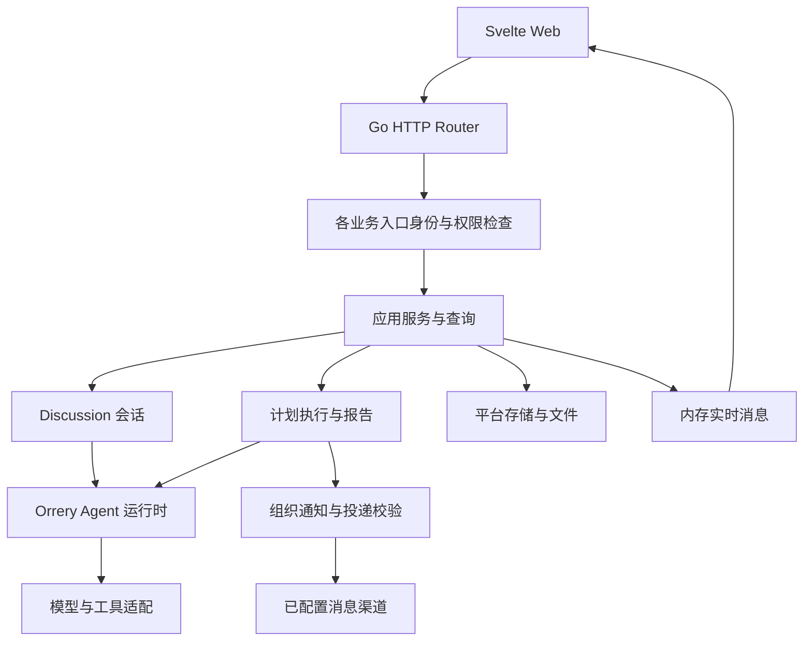
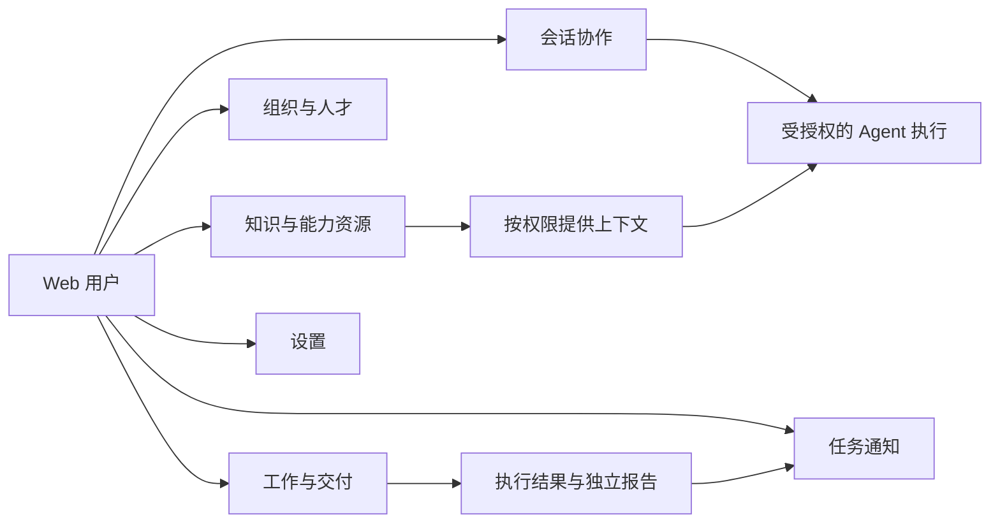

# WEB/API 源码架构

本文描述 2026-10-18 私有开源候选的源码装配，图由本页 Mermaid 文本直接绘制，不使用外部图形、字体文件或生图输出。图中的模块关系不代表线上启用、完整业务验收或公开发布已完成。客户端和 IRIS 不在本次整理范围内；历史完整产品设计另见 [架构草图](architecture-diagrams-draft.md)。

## 技术装配

箭头表示调用或数据流，不替代各入口内的权限检查。消息渠道和模型只有在相应配置、凭据、授权和运行上下文满足条件时才可调用。通知发布和每次外发都重新核对原执行、报告和当前权限；图不能作为外发授权。

| 模块 | 当前源码依据 |
| --- | --- |
| 服务装配、Router 选项和权限依赖 | [main.go](../cmd/server/main.go)、[production_handler_runtime.go](../cmd/server/production_handler_runtime.go) |
| HTTP 路由与 DTO | [HTTP transport](../internal/transport/http) |
| 会话与 Agent 装配 | [Discussion 服务](../internal/app/discussionsession/service.go)、[production_agent_runtime.go](../cmd/server/production_agent_runtime.go) |
| 模型契约 | [Orrery LLM 接口](../internal/agent/llm) |
| 计划报告和通知 | [报告装配](../cmd/server/production_scheduled_reports.go)、[通知装配](../cmd/server/production_task_notifications.go)、[报告通知校验测试](../cmd/server/production_recovered_report_notifications_test.go) |
| 知识向量本地存储 | [jsonstore](../internal/knowledge/vector/jsonstore)、[main.go](../cmd/server/main.go) |
| 图片服务 | [生产图片生成器](../cmd/server/production_image_generation.go)、[图片配置](image-generation-settings.md) |
| 默认头像 | [几何 PNG 生成器](../internal/transport/http/workforce_avatar_artwork.go) |

当前 Web/API 候选不安装 Eino、AionCore、Multica 或 Redis 作为运行依赖。Centrifuge 保留经过裁剪和来源声明的内存模式；知识库的 PageIndex 为独立、按配置接入的适配服务，不是内嵌知识库引擎。完整镜像与原生库的分发审查另行完成。

## 功能入口

入口与权限标签见 [导航定义](../web/src/lib/routes/navigation.ts)；实际读取、写入和租户隔离由服务端路由与应用服务执行。导航可见性不是授权凭据。

## 验证边界

本页可从源码重新审阅和编辑，不依赖 6 张历史架构 PNG。实际测试、候选包哈希及剩余门禁见根目录 [发布状态](../../docs/opensource-web-release-readiness-20261017.md)。Ontology 既有覆盖门禁、RSI 证据投影、真实流式协议、报告状态 API/UI 和完整 F03/F13/F04 业务链仍按该记录继续验收，不能由本页示意图推断已通过。
