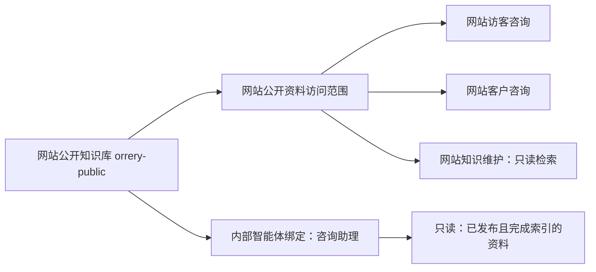

# 网站咨询知识库管理

在 Web 的「资源 → 知识库」管理网站咨询资料：

| 知识库 | 页面标识 | 使用者 |
| --- | --- | --- |
| `orrery-public` | 网站公开资料 | 网站访客咨询 MAX、网站客户咨询、知识维护智能体的只读检索 |
| `website-customer` | 已验证客户资料 | 已验证客户的咨询智能体 |

打开知识库后可以读取正文、上传 UTF-8 Markdown、保存草稿修订、查看历史并发布。
保存修订不会直接替换咨询资料；发布且索引完成后新内容生效，失败时保留原有已发布索引。
首次接入已有目录时复用 PageIndex 文档与索引，并为没有修订记录的文档补录原始内容。

「访问范围与智能体绑定」显示网站的固定使用范围，以及现有的内部授权。
管理员可向内部智能体添加只读、读写或管理授权，也可移除授权；操作使用既有知识库权限 API，
服务器负责检查管理权限。目录成员无法加载时，已有授权仍可显示。

网站咨询范围由服务器的独立凭据、固定目录和来源前缀限制。内部智能体绑定不会改变访客与客户
之间的数据范围。这里的页面标签只用于展示，不能作为访问控制依据。

部署时保留现有 API release，仅激活包含本页面改动的静态 Web 构建，并归档旧 immutable 资源，
以支持仍打开旧页面的浏览器。统一知识服务的实现与回滚说明位于 PageIndex 仓库的
`pageindex-kb-service/docs/unified-knowledge-service.md`。

以下为组件预览截图，使用测试授权数据：

本图使用可编辑源码描述访问与绑定关系。
